# RINDELAB — Comparación visual antes y después

Capturas de escritorio (1440 × 900) y móvil (390 × 900), obtenidas el 18 de octubre de 2026 desde el sitio público y la rama de prueba V2, respectivamente. No son fotomontajes.

## Escritorio

**Antes**

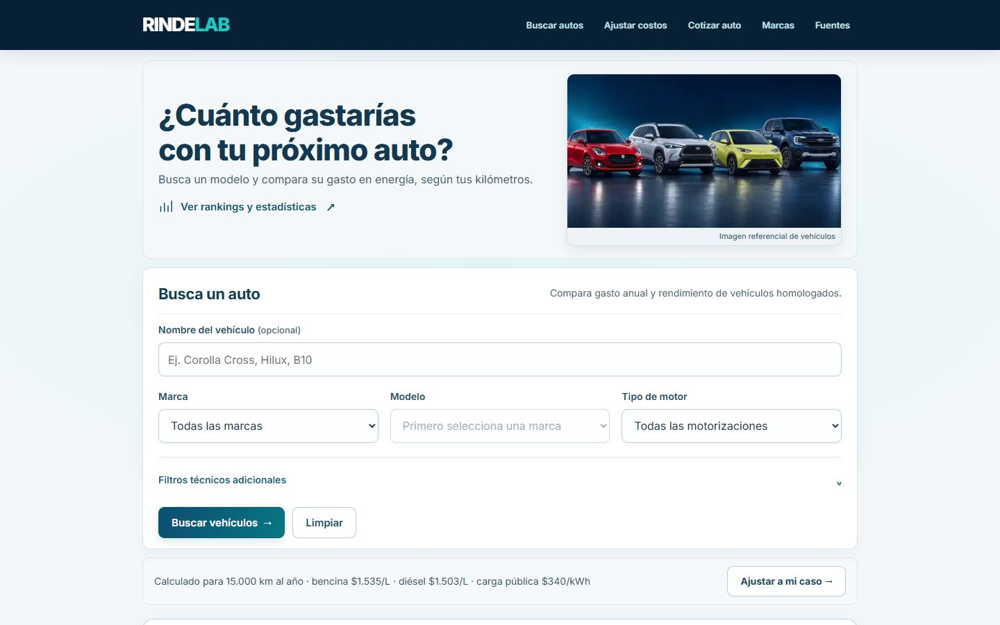

**Después**

## Móvil

**Antes**

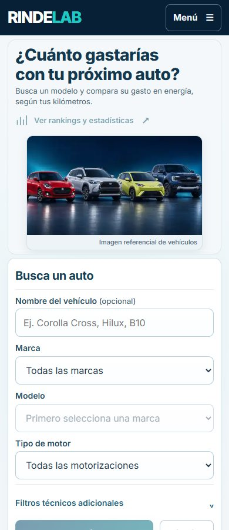

**Después**

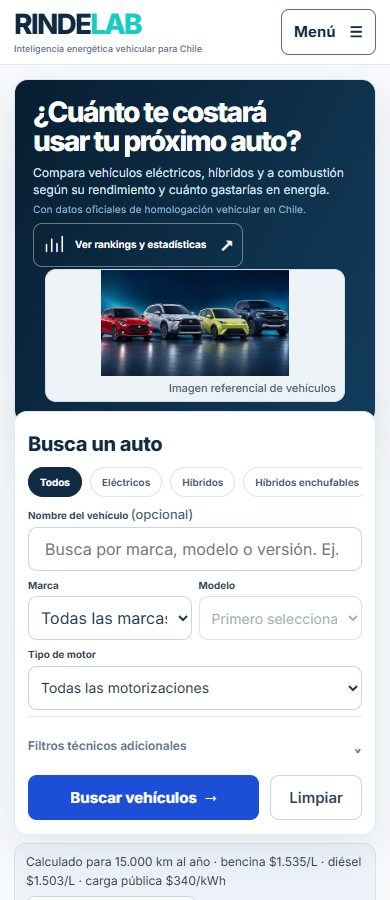

La versión de prueba todavía no está desplegada en GitHub Pages; las capturas «después» proceden del servidor local de validación. Las pruebas automatizadas se ejecutaron además en anchos de 320, 360, 390, 768, 1024, 1440 y 1920 px.

## Segunda etapa — imágenes reales y páginas secundarias

**Resultados automotrices con fotografías verificadas**

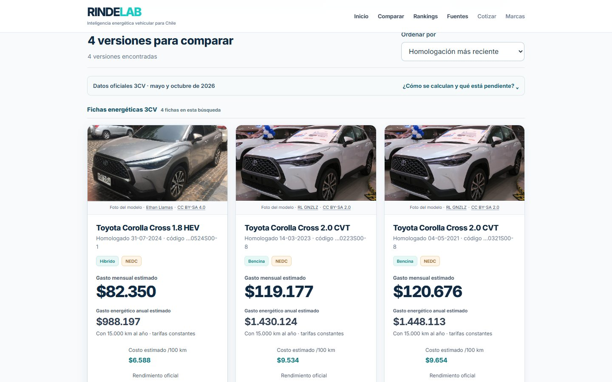

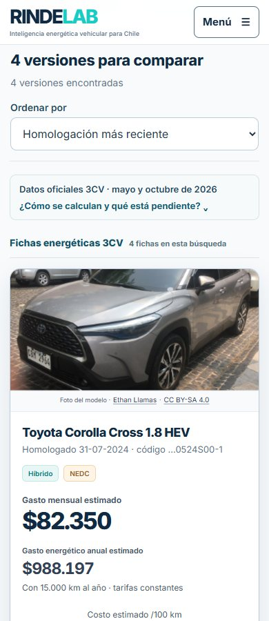

**Cotizador — móvil**

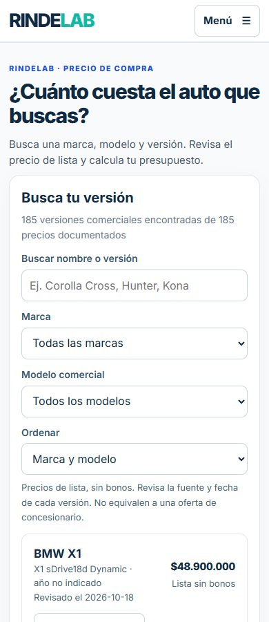

**Marcas y cobertura — móvil**

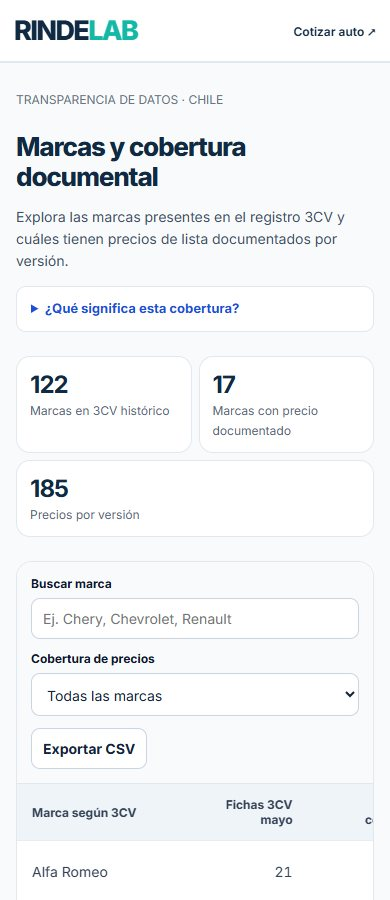

Se mantienen las referencias y autoría originales de los vehículos; estas capturas provienen de la rama candidata. Las fotografías se muestran como imágenes referenciales del modelo y cada ficha enlaza autor y licencia, no como prueba de que una versión comercial concreta corresponda a la homologación consultada.

## Portada simplificada (V2.3)

La página principal ahora separa búsqueda, ajustes y metodología. Los detalles avanzados se abren únicamente cuando se solicitan; los textos oficiales completos se conservaron en `metodologia.html`.

**Portada, escritorio**

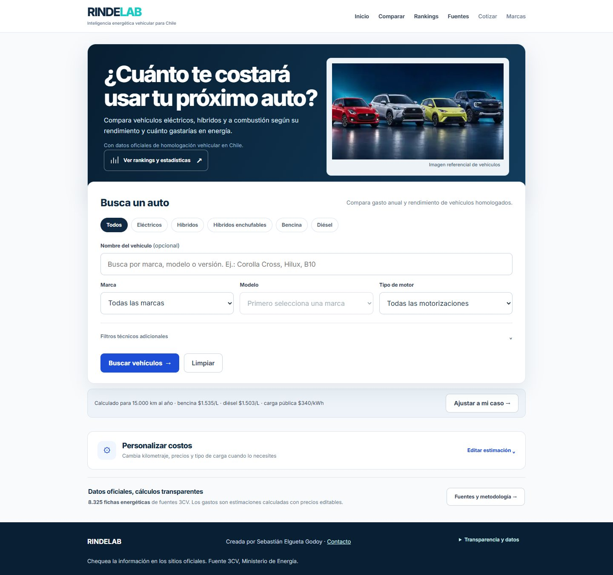

**Portada, celular**

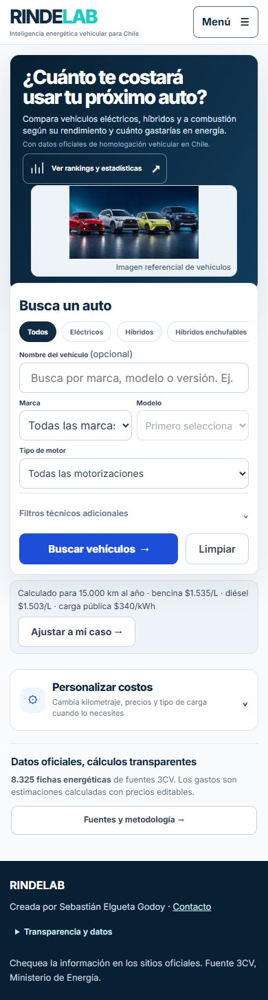

**Ajustes básicos abiertos**

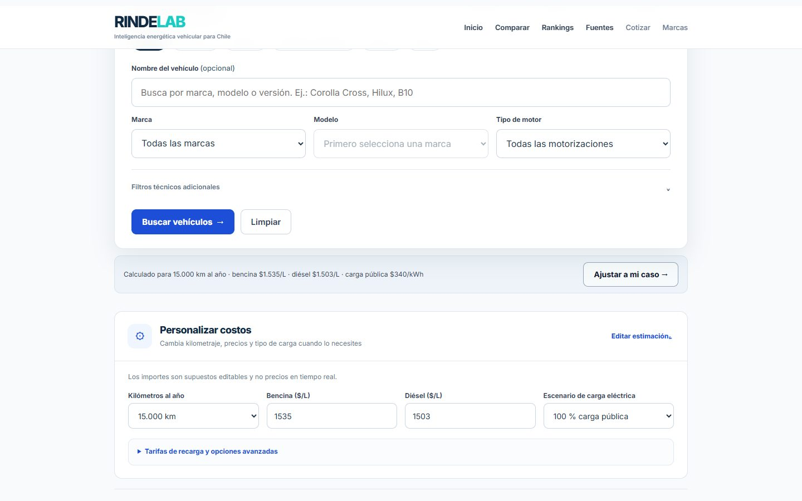

**Documentación independiente**

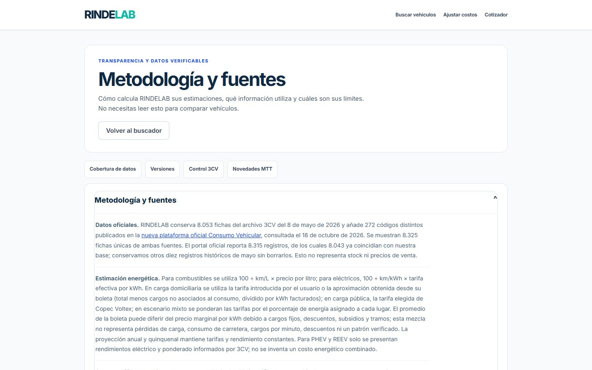
